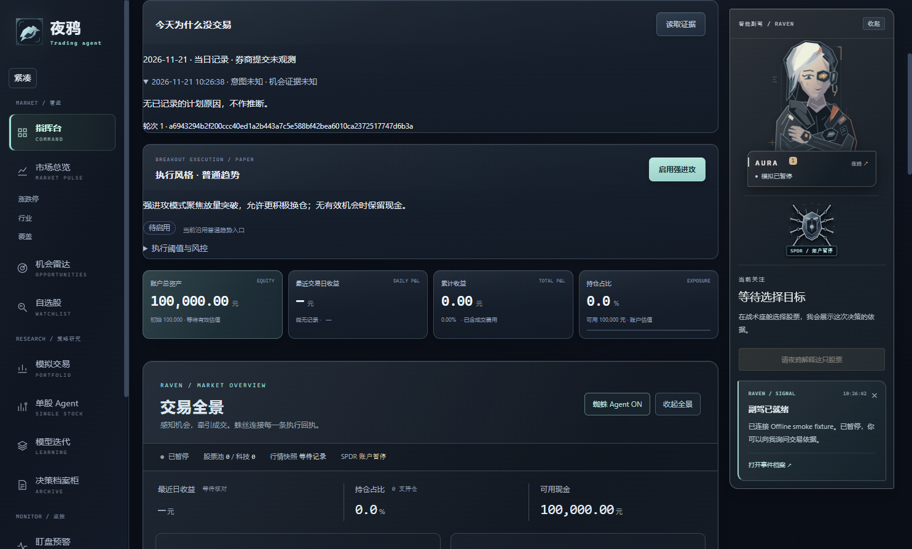
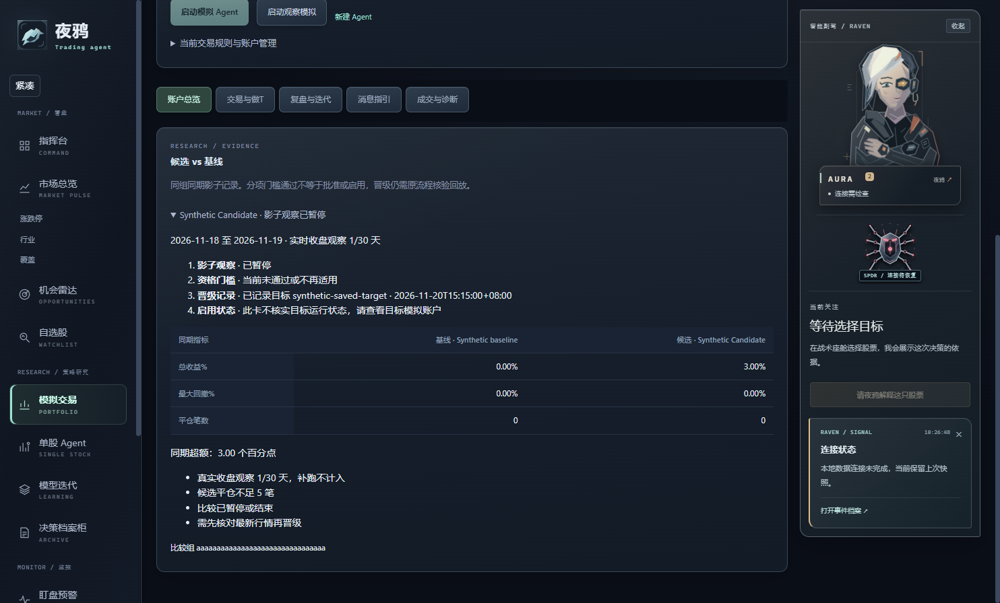

<p align="center">
  
</p>

<p align="center">
  <strong>从看到 A 股异动，到解释为什么没交易、验证新策略能不能替换旧策略。</strong><br>
  在本机完成 AI 投研、策略验证和受 A 股规则约束的模拟；模型提建议，不直接触发下单。
</p>

<p align="center">
  <a href="https://github.com/JefferyCYH/NIGHT-CROWS-TRADING-RELEASES/releases/latest"><strong>下载 Windows 安装包</strong></a>
  · <a href="GUIDE.md">安装与使用指南</a>
  · <a href="SCREENSHOTS.md">界面截图</a>
  · <a href="CHANGELOG.md">版本更新</a>
  · <a href="USAGE.md">使用说明与合作</a>
</p>

<p align="center"><code>v2.0.33</code> · <code>Windows x64</code> · <code>单 EXE 安装</code> · <code>本机工作区</code></p>

[为什么用夜鸦](#为什么用夜鸦) · [功能地图](#功能地图) · [界面预览](#界面预览) · [快速开始](#快速开始) · [架构](#架构) · [开放接口](#开放能力--只读证据) · [性能与下载核对](#性能与下载核对)

## 为什么用夜鸦

行情看板回答「现在发生了什么」。夜鸦把判断依据、风险约束和模拟结果留在同一套工作区里，复盘时不仅能看结果，还能核对**当时知道什么、按什么规则筛选、有没有证据支持下一步**。

| 关注点 | 夜鸦怎么处理 |
| --- | --- |
| **有信号，为什么没交易？** | 在指挥台回查已保存的冻结轮次；区分已记录计划、已观察为零和未知。没有券商提交证据时不推断发生了什么。 |
| **AI 给了新规则，凭什么用它？** | 从论文、公开资料和模拟经历提出假设，保留引用、模型原始输出和实验。固定因子也是研究入口，不必先开通模型服务。 |
| **回测好看，模拟还能成立吗？** | 在 A 股仓位、资金、整手、T+1、涨跌停、费用与止损约束下验证。候选与基线按同组对照，观察、资格、晋级记录和当前启用分别显示。 |
| **行情看到了，能直接用于交易吗？** | 数据健康披露来源、源时间、接收时间、覆盖与使用许可。缺失不当作零，公开展示不当作执行数据。 |
| **资料放哪里、怎么复用？** | 账户、实验和归档保存在本机。演示不用登录；真实工作区的证据需本机认证，只读接口不提供账户操作或下单。 |

## 功能地图

以下按当前公开版能完成的任务分组。

| 用途 | 左侧入口或查看方式 | 能做什么 |
| --- | --- | --- |
| 市场观察 | 市场观察、机会雷达、自选 | 看六大指数、市场分区、机会与自选；通过数据健康判断哪些能力待采集、缺失或过期。 |
| 策略研究 | 模型迭代、模拟交易 | 从固定因子或 AI 假设起步；查实验、验证、候选对照和 A 股风险门槛，通过后由用户确认模拟。 |
| 决策复盘 | Agent 指挥台、决策档案柜 | 看模拟账户、持仓、引擎和市场脉搏；从指挥台回查未交易原因，档案留存研究来源、判断理由和模拟经历。 |
| 演示与扩展 | 登录页只读演示、本机证据接口 | 不配账户或模型也能走完四步样例；登录后通过只读 HTTP 查已存证据。源码 MCP 与 CLI 不随安装版提供。 |
| 界面切换 | 默认量化界面、简洁上班模式 | 按情境切换工作区外观，不改变风险或账户权限。 |

> v2.0.33 中，连板与概念入口展示数据覆盖提示，并非实时榜单。能力以本版和实际数据可用性为准，不从其他市场样本推断当前能力。

## 界面预览


截图来自公开 v2.0.33 解包运行时的隔离合成工作区，不包含用户数据或收益证据。

| 冻结决策：查当时的记录 | 候选对照：查资格与启用 |
| --- | --- |
| [](SCREENSHOTS.md#决策证据) | [](SCREENSHOTS.md#候选-vs-基线) |

[查看完整截图与无凭据演示 →](SCREENSHOTS.md)

## 快速开始

### 先体验：不用账户，也不用模型

1. 从 [v2.0.33 Release](https://github.com/JefferyCYH/NIGHT-CROWS-TRADING-RELEASES/releases/tag/v2.0.33) 下载 **`NightCrows-Setup-2.0.33-win-x64.exe`**，按[使用指南](GUIDE.md#1-下载与文件核对)核对 SHA-256。GitHub 自动生成的源码 ZIP 不是软件安装包。
2. 安装到可写目录，手动打开 `aquant.exe`。安装器不自动启动软件，不连接模型或券商，不执行交易。
3. 在登录页打开「无账号体验只读演示」：从市场和机会一路看到未交易原因、候选与基线。演示只读合成样例，不读取本机私有证据。

### 自己做一轮研究或复盘

1. 建立并登录本机工作区，用「快速新建 Agent」设置股票池、预算与风险限制。
2. 选择固定因子，或在需要 AI 研究时配置自己的模型。查看留存输入、验证和准入状态。
3. 通过门槛后，由你确认是否开始**模拟**。然后回指挥台读决策证据，到「模拟交易」查候选对照。

已有用户请先退出后台和工作进程、备份数据，再用完整安装 EXE 指向原目录。[升级和故障恢复 →](GUIDE.md#4-保留数据升级)

### 第一次打开：沿着一个信号查三件事

1. **数据够不够？** 先看市场观察和数据健康：数据来自哪里、是什么时候的、覆盖多少。缺数据不会被当作零，展示行情也不是执行行情。
2. **看到机会，为什么没交易？** 在指挥台打开「今天为什么没交易」，查已保存轮次的决策。没留证的原因标作未知，不让 AI 用事后解释替代记录。[看冻结决策 →](SCREENSHOTS.md#决策证据)
3. **AI 改了规则，能替换旧策略吗？** 在「候选 vs 基线」先查同组比较，再看观察、资格、晋级记录和当前启用。单次跑赢不是准入，模拟结果也不是实盘成绩。[看候选对照 →](SCREENSHOTS.md#候选-vs-基线)

不用配置模型或账户，就可以按这条路径走完[四步只读演示](SCREENSHOTS.md#无账号演示)。

## 架构

研究提出假设，执行约束筛选模拟动作，档案保存判断依据。三者分开，研究结果不等于执行授权。


- **桌面与权限**：Windows 桌面 WebView 呈现本机工作区；HTTP 服务默认只监听本机。匿名演示和已认证工作区分开。
- **数据与研究**：报价与研究有独立组件。论文和模型给出假设，研究流程保留来源、实验和验证结果。
- **模拟与档案**：风险约束决定是否可执行模拟动作；决策、候选与后续反馈形成可追溯档案。对照收益不是审批结果。

## 开放能力 · 只读证据

在已登录的本机会话里，对当前工作区的本机地址发起 GET。例如，查看该本机服务的 `/api/v1/evidence/data-health`；不复制会话凭据，不将端口暴露给公网。未登录的私有查询会被拒绝。

| 资源（前缀 `/api/v1/evidence/`） | 参数 | 可查看 |
| --- | --- | --- |
| `data-health` | 无 | 数据能力、状态和观察口径 |
| `decisions` | `id`、北京时间 `date`，可选 `limit` | 已保存模拟决策，不推断券商提交 |
| `candidate-progress` | `id`、`group` | 已保存的候选、基线和晋级门槛 |
| `replay-report` | `id` | 回放摘要，不触发新回放 |

独立 **stdio MCP** 与三个 CLI 属于获授权开发者的源码流程，**不是这个 EXE 的命令或公开源码**。CLI 可用固定样例读取指数源、查隔离账本的决策、比对候选。MCP 健康工具只读显式保存的快照，不实时抓行情；没有快照则报告缺失。两者都不提交审批或交易。

## 性能与下载核对

- 工作区隐藏时减少时钟更新和新的 Agent 快照读取；启动时清理过期诊断记录。预置过期数据的隔离演练回收了空间，不代表长期占盘或整机提速。
- 工程测试分别核对安装文件、合成账户的升级和回滚、页面导航与只读边界。通过接口测试窗口恢复和退出，不等于通过物理托盘、真实旧账户、实盘或全天负载验收。
- 当前安装器未签名；应核对官方 Release 与 SHA-256，而不是关闭安全防护。单 EXE 指下载分发形式，安装后仍有运行库目录。

**v2.0.33 安装 EXE · SHA-256**

```text
77e5e8b387e7eb8c6ce335e2df47b2b2e5da9ecaa2b92c72af4ca0c9cdf562e7
```

[安装参数与升级](GUIDE.md) · [版本记录](CHANGELOG.md) · [下载 EXE](https://github.com/JefferyCYH/NIGHT-CROWS-TRADING-RELEASES/releases/download/v2.0.33/NightCrows-Setup-2.0.33-win-x64.exe)

## 文档索引

| 你的问题 | 从这里开始 |
| --- | --- |
| 第一次安装、从旧版升级或需要恢复 | [安装与使用指南](GUIDE.md) |
| 想先看界面和研究流程 | [指挥台、演示、决策与候选截图](SCREENSHOTS.md) |
| 想知道这个版本实际发布了什么 | [版本更新日志](CHANGELOG.md) · [安装包与版本记录](https://github.com/JefferyCYH/NIGHT-CROWS-TRADING-RELEASES/releases) |
| 想了解授权、反馈或合作 | [使用说明与合作](USAGE.md) |

## 使用边界与反馈

- 本机运行不等于全程离线：外部行情与模型功能可能联网，请确认服务政策、费用和数据授权。不要共享凭据、真实持仓或研究原件。
- 夜鸦仅供学习和研究，不可商用，不构成投资建议，不保证收益。模拟、回测与候选晋级记录不是实盘交易证明。
- 反馈时请提供版本、复现步骤和脱敏截图。[使用与合作](USAGE.md) · 微信 `JefferyCYH`。

文档组织参考了 [tick-stock-panel](https://github.com/shy3130/tick-stock-panel) 的功能地图、界面预览、架构、开放接口和快速开始；内容与截图来自夜鸦。
