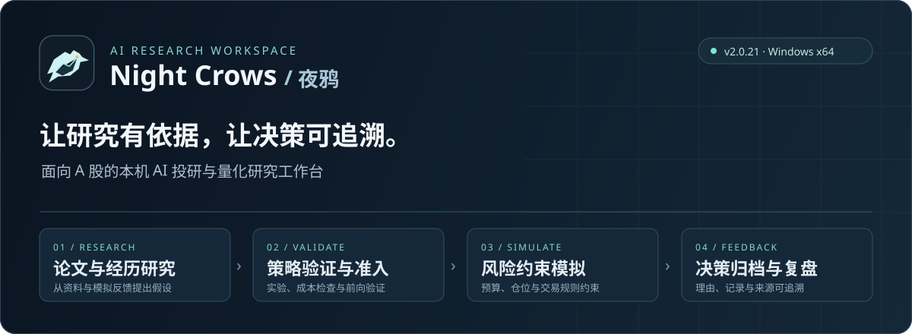
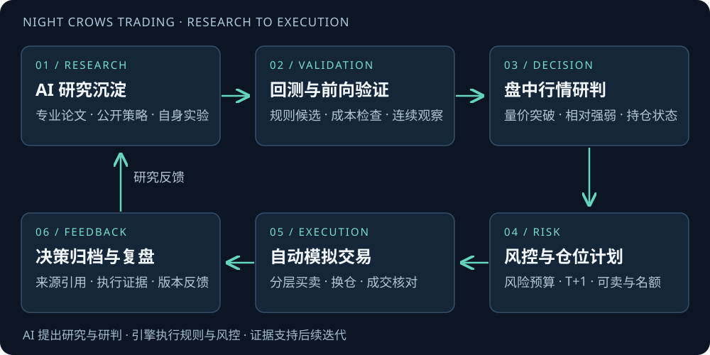
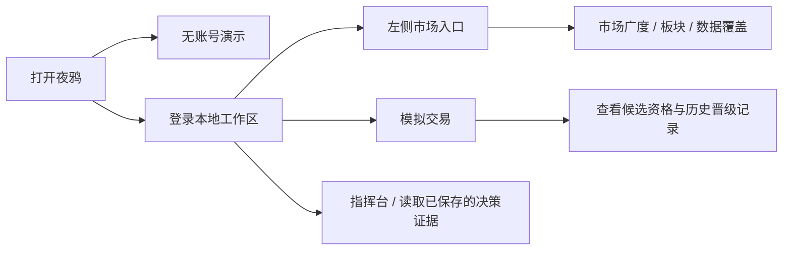

<p align="center">
  
</p>

<p align="center">
  <strong>让研究有依据，让决策可追溯。</strong><br>
  面向 A 股的本机 AI 投研与量化研究工作台，把论文研究、策略验证、风险约束模拟和决策复盘串成一个闭环。
</p>

<p align="center">
  <a href="https://github.com/JefferyCYH/NIGHT-CROWS-TRADING-RELEASES/releases/latest"><strong>下载 Windows 安装包</strong></a>
  · <a href="GUIDE.md">安装与使用</a>
  · <a href="CHANGELOG.md">版本更新</a>
  · <a href="USAGE.md">使用说明与合作</a>
</p>

<p align="center"><code>Windows x64</code> · <code>v2.0.33</code> · <code>本机运行</code> · <code>单 EXE 安装分发</code></p>

---

## 不止看信号，更要理解信号从哪里来

夜鸦将 AI 放在研究与复盘的流程中，而不是把一段模型回答直接当作交易指令。从专业论文、公开资料和自己的模拟经历提出假设，经验证和风险检查后形成候选规则；决策档案保留来源、理由、实验结果及后续反馈，方便回看“为什么这样做”。

**适合量化学习者、策略研究者，以及希望探索 AI 如何参与投研流程的个人用户。** 本项目以研究学习和模拟验证为定位，不提供收益承诺。

## 一个工作台，六项核心能力

| 能力 | 你可以做什么 |
| :--- | :--- |
| **AI 研究与知识沉淀** | 将论文、公开资料与模拟经历组织成研究输入，保存原始回复、引用与候选假设。 |
| **策略验证与准入** | 在实验、费用检查和前向验证之间区分研究结果与可生效规则，保留未通过候选及回退记录。 |
| **市场观察与股票池** | 在同一工作台查看市场总览、股票池观察、行情与持仓状态。 |
| **风险约束模拟** | 结合预算、仓位、整手、费用、T+1 与止损等约束，学习信号如何转化为模拟执行。 |
| **可追溯决策档案** | 回看买卖原因、成交记录和研究来源，让下一轮研究有据可循。 |
| **两套可切换界面** | 原版量化界面与简洁的“上班模式”自由切换，偏好本机保存；切换不改变交易权限。 |

<p align="center">
  
</p>

## 几分钟开始第一次研究

1. **下载安装**：前往 [公开 Release](https://github.com/JefferyCYH/NIGHT-CROWS-TRADING-RELEASES/releases/tag/v2.0.33)，只下载 `NightCrows-Setup-2.0.33-win-x64.exe`。
2. **手动启动**：选择自己可写的目录安装，完成后打开该目录中的 `aquant.exe`。
3. **建立研究环境**：设置本机账号，快速新建 Agent，配置自己的模型服务或选择固定因子研究，再设置股票池、预算和风险限制。
4. **先研究，再模拟**：核对研究与验证状态；符合准入条件后，由你确认启动模拟。

> 安装器不会自动启动程序或交易。模型配置、网络可用性和数据质量会影响相关功能；缺少模型、研究失败或未通过准入时，不会自动启动模拟交易。可选深度学习不包含完整训练环境，详见 [使用指南](GUIDE.md)。

### 当前版本 · 2.0.33

- 数据健康矩阵刷新或重排后，已展开的能力详情保持展开。

- 减少后台开销：隐藏时暂停工作区时钟、跳过新的 Agent 快照读取；恢复时立即更新时间。未证实整机提速或内存下降。

- 登录前可运行无账号只读演示；登录后可从左栏进入市场分区、检查数据健康和决策证据。
- 候选证据卡区分观察、资格、已记录晋级和未经核实的启用状态。
- 启动时清理过期诊断记录并回收空间；隔离测试数据库从约 16 MiB 缩至 24 KiB，未验证长期写入表现。上班模式继续保留。
- 对外以**一个 Windows 安装 EXE**交付，内含主程序和配套研究、报价组件。
- 升级使用完整安装包，选择原安装目录可保留配置与用户数据；升级前请备份并退出相关进程。

[查看完整更新](CHANGELOG.md) · [直接下载安装 EXE](https://github.com/JefferyCYH/NIGHT-CROWS-TRADING-RELEASES/releases/download/v2.0.33/NightCrows-Setup-2.0.33-win-x64.exe)

## 下载与安全边界

| 项目 | 说明 |
| :--- | :--- |
| 平台 | Windows x64；其他平台暂无安装包 |
| 安装包 | `NightCrows-Setup-2.0.33-win-x64.exe` · 67.13 MiB |
| 发布签名 | 当前未进行发布者代码签名，可能出现未知发布者提示；请核对来源与哈希，不要关闭安全防护 |
| 源码 | 本仓库仅存放公开介绍、使用说明和展示素材；**应用源码不公开** |
| 升级 | 使用完整 EXE；不支持源码 ZIP 补丁，不要混装旧运行组件 |

**SHA-256**

```text
77e5e8b387e7eb8c6ce335e2df47b2b2e5da9ecaa2b92c72af4ca0c9cdf562e7
```

“单 EXE”指下载和分发的安装文件，安装后仍有运行库目录。减少可读 Python 源码暴露不等于防逆向：字节码仍可能被反编译，前端资源仍可阅读。

## v2.0.28 新功能

> v2.0.28 已公开发布；安装包和 SHA256SUMS.txt 已通过匿名下载校验。

### 从哪里开始



这张图只说明入口，不表示候选已启用或获得交易权限。具体操作见[使用指南](GUIDE.md#v2028-预览先体验再检查证据)。

### 三条上手路线

| 想做什么 | 推荐路径 | 看懂哪一步 |
| --- | --- | --- |
| 不注册，先看软件怎么工作 | 登录页 → 无账号体验只读演示 → 市场 → 机会 → 决策 → 候选 | 演示全是合成值，不代表当前市场，也不读取自己的工作区 |
| 排查为什么没有模拟交易 | 指挥台 → 选模拟账户 → 今天为什么没交易 → 读取证据 | 未采集、已采集但为零、存在模拟意图是不同状态；没有券商证据时不能判断是否提交 |
| 看候选模型是否值得继续观察 | 模拟交易 → 候选对照 → 核对比较组、观察期、收益差、回撤及样本门槛 | 门槛通过、已记录晋级、已启用是不同状态，不能用一个指标代替 |

### 桌面安装包验证

- 左侧「涨跌停」「行业」「覆盖」会聚焦并滚动到对应分区。隔离 WebView 中，1,200 次脚本跳转均在下一动画帧观察到标题进入视口；这不是实际画面呈现延迟。
- 当前对照未证明整体提速、内存降低或磁盘节省。安装、升级和数据保留范围见[使用指南](GUIDE.md)。

### 常见问题

- **当前日线检查覆盖什么？** 「沪深指数成交额」只核对两个指数最近五个共同完整交易日的样本，不代表个股日线覆盖。复权、分钟、五档和财务尚无已验证样本，不能从指数结果推断这些能力。
- **为什么数据健康显示未知？** 尚无可核验的来源、时间或覆盖样本时会显示未知。它不是零覆盖，也不是交易许可。
- **哪里能看到连板和概念行情？** 左栏入口当前直达覆盖提示，说明数据边界，不是新增的实时榜单。
- **如何校验下载文件？** 在下载目录运行 `Get-FileHash .\NightCrows-Setup-2.0.33-win-x64.exe -Algorithm SHA256`，与同一 Release 说明中的 SHA-256 比对。校验和验证文件一致性，不替代数字签名。
- **升级时哪些操作更稳妥？** 先退出托盘进程并备份工作区。遇到占用提示先正常退出再重试，不手动覆盖安装目录中的 DLL。

### 开放能力

本机 HTTP v1 证据接口需登录，提供 `decisions`、`data-health`、`candidate-progress` 和 `replay-report` 四个只读资源，路径前缀 `/api/v1/evidence/`。请勿将工作区会话交给第三方或暴露本机端口。

独立 stdio MCP 在源码侧验证了 `decisions`、`candidate_progress`、`replay_report` 和 `data_health`。其中 `data_health` 只读取显式配置的已保存快照，不实时连接桌面；没有快照时不推断能力。MCP 不提供交易写入，不随 Windows 安装器作为独立程序分发。源码侧三个可运行示例分别演示读取指数源、查询已保存决策、对照候选。指数示例默认使用固定 mock，显式选择实时模式才访问东方财富公开接口，两种输出均仅供展示。后两个示例使用隔离数据副本，不修改账本或提交审批。公开安装包不等于开放内部源码或附带开发运行环境。

## 研究边界与反馈

夜鸦不构成投资建议，不承诺收益；回测、模型观点与模拟结果均不能代表未来表现。本版未完成券商实盘联调验收，不应作为实盘下单依据。

应用使用各用户自己的账号、数据与模型配置，发布包不携带用户账户或密钥。**“本机运行”不代表全程离线**：行情与模型服务可能访问外部网络，发送到外部服务的内容由所选功能和配置决定。请自行确认供应方政策、费用与数据使用条件，不要上传敏感资料。

反馈时请附版本、复现步骤和脱敏信息，不要公开账号、密码、密钥、持仓或个人研究原件。产品交流、研究工具共建与合作可联系下方微信。

---

**不可用于商用，仅供学习。**  
**合作微信：JefferyCYH**

## 从哪里开始？

| 我想做什么 | 推荐入口 | 使用边界 |
| --- | --- | --- |
| 不配置账户先看效果 | 无凭据演示：市场、机会、决策、对比 | 示例证据，不接券商，不代表实时行情 |
| 判断数据是否可用 | 工作区的数据健康矩阵 | 区分可用、缺失和降级，不把缺失当作正常 |
| 回看某次研究判断 | 决策证据卡 | 对照输入、依据和反证，不是买卖建议 |
| 理解候选当前处于哪一步 | 候选审批进度和历史记录 | 历史审批不等于当前启用 |
| 用工具读取研究结果 | 本地工作区的 v1 只读 HTTP 接口 | 私有证据需要本地授权；独立 MCP 与二开示例在源码侧运行，不随安装器提供 |
