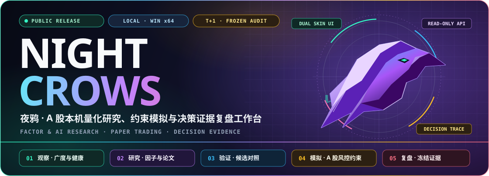
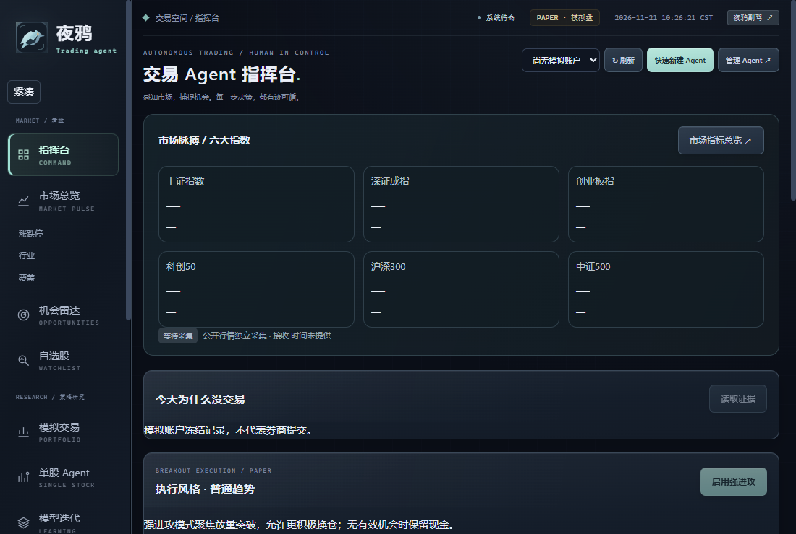

  

# Night Crows · 夜鸦 A 股量化研究工作台

**从一个盘面信号追到可验证的假设，从一句「今天为什么没交易」查到当时的决策记录。**

夜鸦把市场观察、固定因子与 AI 投研、受 A 股规则约束的模拟和决策复盘放在同一个本机工作区。模型可以提出研究假设，不直接下单；信号、模拟意图与券商提交是不同的记录。

<code>公开版 v2.0.33</code> · <code>Windows x64</code> · <code>单 EXE 安装</code> · <code>本机工作区</code>

  <a href="https://github.com/JefferyCYH/NIGHT-CROWS-TRADING-RELEASES/releases/latest"><strong>↓ 下载 Windows 安装包</strong></a>
  · <a href="#第一次打开四步看懂一条决策">四步无账号演示</a>
  · <a href="SCREENSHOTS.md">查看界面截图</a>
  · <a href="GUIDE.md">安装与升级</a>

[界面预览](#界面预览) · [为什么用夜鸦](#为什么用夜鸦) · [功能地图](#功能地图) · [快速开始](#快速开始) · [开放接口](#开放能力--只读证据) · [性能与下载核对](#性能与下载核对)

> [!NOTE]
> 本页只介绍当前公开安装版 **v2.0.33**。连板和概念在本版是数据覆盖入口，不是实时榜单。本仓库提供安装包、使用说明和截图，不提供应用源码。

## 界面预览

| **查一轮决策的原始依据** | **查候选是否达到准入门槛** |
| --- | --- |
|  |  |

以上来自 v2.0.33 的隔离合成工作区，不含真实账户、订单或收益。[浏览完整图册 →](SCREENSHOTS.md)

## 为什么用夜鸦

夜鸦把行情、研究和模拟分别留档。复盘时，不必用现在的行情或模型回答去猜当时发生了什么。

| 步骤 | 先查什么 | 不把什么混为一谈 |
| --- | --- | --- |
| **01 · 观察** | 先看数据源、时间和覆盖，再看指数、板块与机会雷达。 | 没有报价 ≠ 没有信号；可展示 ≠ 可执行。 |
| **02 · 研究** | 可不配置模型，先从固定因子开始；也可让 AI 从论文或资料提出假设，并保留出处与实验记录。 | AI 提案 ≠ 可直接启用的策略。 |
| **03 · 验证** | 比较同组、同期的候选和基线，检查观察期与准入条件。 | 阶段性领先 ≠ 达到门槛；有晋级记录 ≠ 已启用。 |
| **04 · 模拟** | 按仓位、现金、整手、T+1、涨跌停和费用等约束检查模拟动作。 | 有信号 ≠ 有可执行的模拟意图。 |
| **05 · 复盘** | 打开冻结轮次，核对当时可见的数据、拦截原因和已留下的记录。 | 模拟意图 ≠ 券商提交；没有记录就标为未知。 |

## 功能地图

以下是原版界面的十个主入口。可在原版量化终端和简洁上班模式间切换；切换外观不改变账户、策略或权限。

| 分组 | 左侧入口 | 可以做什么 |
| --- | --- | --- |
| 看盘 | **指挥台** | 看模拟账户、引擎状态、市场脉搏，以及「今天为什么没交易」。 |
| 看盘 | **市场总览** | 看六大指数、涨跌停、行业及数据健康；用覆盖状态判断哪些数据尚未采集或已过期。 |
| 看盘 | **机会雷达** | 找研究线索，区分触发信号、无信号和数据不足。 |
| 看盘 | **自选股** | 管理观察名单，从个股进入后续研究。 |
| 策略研究 | **模拟交易** | 查看模拟账户、持仓和实验，从「候选 vs 基线」核对已保存的准入证据。 |
| 策略研究 | **单股 Agent** | 围绕单个标的查看信息或开展研究。 |
| 策略研究 | **模型迭代** | 做固定因子实验，或把论文、文章的研究假设留存并验证。 |
| 策略研究 | **决策档案柜** | 查找已保存的研究来源、判断依据与模拟记录。 |
| 监控 | **盯盘预警** | 按本机配置查看关注标的的异动与预警。 |
| 系统 | **系统连接** | 配置行情与模型、管理本机工作区。 |

## 快速开始

1. 从 [v2.0.33 Release](https://github.com/JefferyCYH/NIGHT-CROWS-TRADING-RELEASES/releases/tag/v2.0.33) 下载 **`NightCrows-Setup-2.0.33-win-x64.exe`**，先按[下方说明](#性能与下载核对)核对 SHA-256。GitHub 自动生成的 Source code ZIP/TAR 不是安装包。
2. 安装到可写目录，手动打开 `aquant.exe`。安装器不自动启动应用，不连接模型或券商，不执行交易。
3. **先体验**：在登录页点「无账号体验只读演示」，不用配置账户、行情源或模型。**开始研究**：创建本机账号，从「快速新建 Agent」设置标的、预算和风险限制；核对实验结果后，由你确认是否启动模拟。

已有用户请先退出主程序和工作进程并备份，再把新安装器指向原安装目录。[升级和故障恢复 →](GUIDE.md#4-保留数据升级)

### 第一次打开：四步看懂一条决策

以下是应用内的固定合成样例，不取实时行情，也不对应任何真实账户或收益。

| 步骤 | 样例给出的记录 | 应该如何读 |
| --- | --- | --- |
| **1. 市场快照** | 观察池三只标的，只有两只获得有效报价。 | 先看覆盖；缺报价不等于价格没变。 |
| **2. 机会雷达** | A 有信号，B 无信号，C 数据不足。 | 「无信号」和「未知」是两回事。 |
| **3. 为什么没交易** | 可用现金 1,000 元，预留需求 1,520 元。 | 现金约束拦截，记录为零意图；券商提交仍未观测。 |
| **4. 候选 vs 基线** | 样例扣费收益为 +0.9% / +0.6%，只观察了 3 / 20 个收盘日。 | 同期领先也没达到准入门槛，不代表已晋级或启用。 |

[演示截图](SCREENSHOTS.md#无账号演示) · [决策证据](SCREENSHOTS.md#决策证据) · [候选对照](SCREENSHOTS.md#候选-vs-基线)

## 架构

桌面工作区通过 Windows WebView 提供界面，本机 HTTP 服务默认只监听本机。报价与研究分开处理；模拟引擎按资金和风控条件筛选动作，档案保留判断依据。匿名演示与已认证的本机工作区分开，演示不会读取个人资料。

## 开放能力 · 只读证据

在已登录的本机会话中，向当前工作区的本机地址发起 `GET`，例如 `/api/v1/evidence/data-health`。接口只读取已存证据，不提供下单、审批或启用操作。请勿暴露本机端口或共享会话凭据。

| 资源（前缀 `/api/v1/evidence/`） | 参数 | 可查看 |
| --- | --- | --- |
| `data-health` | 无 | 数据能力、状态与观察口径 |
| `decisions` | `id`、北京时间 `date`，可选 `limit` | 已存模拟决策，不推断券商提交 |
| `candidate-progress` | `id`、`group` | 已存候选、基线与准入门槛 |
| `replay-report` | `id` | 已存回放摘要，不触发新回放 |

独立 stdio MCP 与 CLI 属于获授权开发者的源码流程，**不随公开 EXE 提供**。

## 性能与下载核对

| 安装版本 | 正式安装附件 | SHA-256 |
| --- | --- | --- |
| **v2.0.33** · Windows x64 | [NightCrows-Setup-2.0.33-win-x64.exe](https://github.com/JefferyCYH/NIGHT-CROWS-TRADING-RELEASES/releases/download/v2.0.33/NightCrows-Setup-2.0.33-win-x64.exe) | `77e5e8b387e7eb8c6ce335e2df47b2b2e5da9ecaa2b92c72af4ca0c9cdf562e7` |

- 安装器未签名。请核对官方发布页和 [SHA-256](GUIDE.md#1-下载与文件核对)，不要为安装关闭安全防护。单 EXE 指下载形式，安装后仍有配套运行库。
- 隐藏界面时减少时钟刷新和新的 Agent 快照读取；隔离验证中，启动时清理了预置的过期诊断记录。这不等于整机提速或长期占盘结论。
- 安装、合成账户升级与回滚、页面导航及只读边界有隔离测试；接口测试不能代替物理托盘、真实旧账户、完整交易日或实盘验收。

## 文档索引

| 我想… | 从这里开始 |
| --- | --- |
| 下载安装、升级或恢复 | [安装与使用指南](GUIDE.md) |
| 先看界面，再走一遍证据 | [截图与无账号演示](SCREENSHOTS.md) |
| 确认这个版本改了什么 | [版本更新日志](CHANGELOG.md) · [所有 Release](https://github.com/JefferyCYH/NIGHT-CROWS-TRADING-RELEASES/releases) |
| 了解授权，反馈问题或开展合作 | [使用说明与合作](USAGE.md) |

## 使用边界与反馈

本机运行不代表所有功能离线。启用外部行情或模型时，请先确认费用、数据授权与隐私政策。夜鸦不构成投资建议，不保证收益；回测、模拟与候选准入记录不作为实盘依据。反馈时请提供版本、复现步骤与脱敏截图，不要上传凭据、真实持仓或个人研究资料。

**不可用于商用，仅供学习。**

**合作微信：JefferyCYH**
