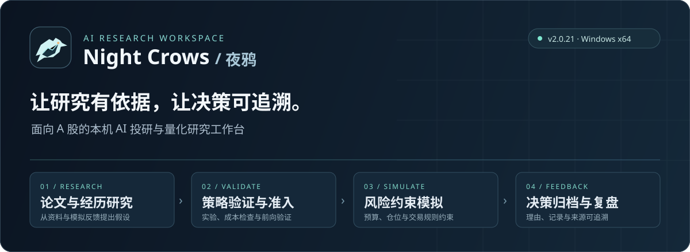
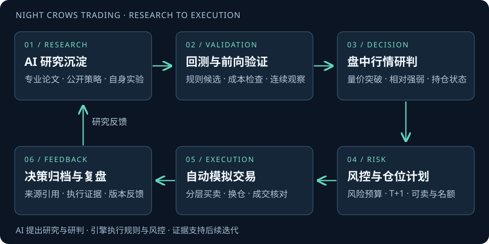

<p align="center">
  
</p>

<p align="center">
  <strong>让研究有依据，让决策可追溯。</strong><br>
  面向 A 股的本机 AI 投研与量化研究工作台，把论文研究、策略验证、风险约束模拟和决策复盘串成一个闭环。
</p>

<p align="center">
  <a href="https://github.com/JefferyCYH/NIGHT-CROWS-TRADING-RELEASES/releases/latest"><strong>下载 Windows 安装包</strong></a>
  · <a href="GUIDE.md">安装与使用</a>
  · <a href="CHANGELOG.md">版本更新</a>
  · <a href="USAGE.md">使用说明与合作</a>
</p>

<p align="center"><code>Windows x64</code> · <code>v2.0.21</code> · <code>本机运行</code> · <code>单 EXE 安装分发</code></p>

---

## 不止看信号，更要理解信号从哪里来

夜鸦将 AI 放在研究与复盘的流程中，而不是把一段模型回答直接当作交易指令。从专业论文、公开资料和自己的模拟经历提出假设，经验证和风险检查后形成候选规则；决策档案保留来源、理由、实验结果及后续反馈，方便回看“为什么这样做”。

**适合量化学习者、策略研究者，以及希望探索 AI 如何参与投研流程的个人用户。** 本项目以研究学习和模拟验证为定位，不提供收益承诺。

## 一个工作台，六项核心能力

| 能力 | 你可以做什么 |
| :--- | :--- |
| **AI 研究与知识沉淀** | 将论文、公开资料与模拟经历组织成研究输入，保存原始回复、引用与候选假设。 |
| **策略验证与准入** | 在实验、费用检查和前向验证之间区分研究结果与可生效规则，保留未通过候选及回退记录。 |
| **市场观察与股票池** | 在同一工作台查看市场总览、股票池观察、行情与持仓状态。 |
| **风险约束模拟** | 结合预算、仓位、整手、费用、T+1 与止损等约束，学习信号如何转化为模拟执行。 |
| **可追溯决策档案** | 回看买卖原因、成交记录和研究来源，让下一轮研究有据可循。 |
| **两套可切换界面** | 原版量化界面与简洁的“上班模式”自由切换，偏好本机保存；切换不改变交易权限。 |

<p align="center">
  
</p>

## 几分钟开始第一次研究

1. **下载安装**：前往 [公开 Release](https://github.com/JefferyCYH/NIGHT-CROWS-TRADING-RELEASES/releases/tag/v2.0.21)，只下载 `NightCrows-Setup-2.0.21-win-x64.exe`。
2. **手动启动**：选择自己可写的目录安装，完成后打开该目录中的 `aquant.exe`。
3. **建立研究环境**：设置本机账号，快速新建 Agent，配置自己的模型服务或选择固定因子研究，再设置股票池、预算和风险限制。
4. **先研究，再模拟**：核对研究与验证状态；符合准入条件后，由你确认启动模拟。

> 安装器不会自动启动程序或交易。模型配置、网络可用性和数据质量会影响相关功能；缺少模型、研究失败或未通过准入时，不会自动启动模拟交易。可选深度学习不包含完整训练环境，详见 [使用指南](GUIDE.md)。

### 当前版本 · 2.0.21

- 新增可切换的上班模式，原版界面默认保留；在上班模式左下角齿轮中切回原版。
- 对外以**一个 Windows 安装 EXE**交付，内含主程序和配套研究、报价组件。
- 升级使用完整安装包，选择原安装目录可保留配置与用户数据；升级前请备份并退出相关进程。

[查看完整更新](CHANGELOG.md) · [直接下载安装 EXE](https://github.com/JefferyCYH/NIGHT-CROWS-TRADING-RELEASES/releases/download/v2.0.21/NightCrows-Setup-2.0.21-win-x64.exe)

## 下载与安全边界

| 项目 | 说明 |
| :--- | :--- |
| 平台 | Windows x64；其他平台暂无安装包 |
| 安装包 | `NightCrows-Setup-2.0.21-win-x64.exe` · 105.72 MiB |
| 发布签名 | 当前未进行发布者代码签名，可能出现未知发布者提示；请核对来源与哈希，不要关闭安全防护 |
| 源码 | 本仓库仅存放公开介绍、使用说明和展示素材；**应用源码不公开** |
| 升级 | 使用完整 EXE；不支持源码 ZIP 补丁，不要混装旧运行组件 |

**SHA-256**

```text
b72c6fce0351c7452bddc033f990e1c6df44bf67501e8ce472d0d02cdb4c6f22
```

“单 EXE”指下载和分发的安装文件，安装后仍有运行库目录。减少可读 Python 源码暴露不等于防逆向：字节码仍可能被反编译，前端资源仍可阅读。

## 研究边界与反馈

夜鸦不构成投资建议，不承诺收益；回测、模型观点与模拟结果均不能代表未来表现。本版未完成券商实盘联调验收，不应作为实盘下单依据。

应用使用各用户自己的账号、数据与模型配置，发布包不携带用户账户或密钥。**“本机运行”不代表全程离线**：行情与模型服务可能访问外部网络，发送到外部服务的内容由所选功能和配置决定。请自行确认供应方政策、费用与数据使用条件，不要上传敏感资料。

反馈时请附版本、复现步骤和脱敏信息，不要公开账号、密码、密钥、持仓或个人研究原件。产品交流、研究工具共建与合作可联系下方微信。

---

**不可用于商用，仅供学习。**  
**合作微信：JefferyCYH**
