<a id="top"></a>

<div align="center">


<br>

<picture>
  <source media="(prefers-color-scheme: dark)" srcset="docs/assets/readme/logo-mark-dark.svg">
  <source media="(prefers-color-scheme: light)" srcset="docs/assets/readme/logo-mark-light.svg">
  
</picture>

# NIGHT CROWS · 夜鸦 A 股量化研究工作台

**从一笔盘面异动定位可检验的研究线索，从一次「今天为什么没交易」穿透到冻结轮次证据。**

<sub>本机优先桌面终端 · 4 组 10 页工作区 · 双套视觉皮肤 · 固定因子与 AI 论文研究 · A 股制度级模拟 · 单向只读 HTTP / MCP 生态</sub>

<br><br>

<p>
  <a href="https://github.com/JefferyCYH/NIGHT-CROWS-TRADING-RELEASES/releases/latest"></a>
  
  
</p>
<p>
  
  
  
</p>
<p>
  
  <a href="#开放接口"></a>
  <a href="#性能验收与安全边界"></a>
</p>

<p>
  <a href="https://github.com/JefferyCYH/NIGHT-CROWS-TRADING-RELEASES/releases/latest"></a>&nbsp;&nbsp;
  <a href="#第一次打开四步看懂一条决策"></a>&nbsp;&nbsp;
  <a href="docs/workspace-gallery.md"></a>
</p>

<kbd><a href="#界面预览">01 · 界面与双皮肤</a></kbd>&nbsp;
<kbd><a href="#为什么用夜鸦">02 · 核心优势</a></kbd>&nbsp;
<kbd><a href="#功能地图">03 · 十页功能地图</a></kbd>&nbsp;
<kbd><a href="#快速开始">04 · 快速开始</a></kbd>&nbsp;
<kbd><a href="#架构与数据流">05 · 系统架构</a></kbd>
<br>
<kbd><a href="#ai-副驾-aura">06 · AURA 副驾</a></kbd>&nbsp;
<kbd><a href="#开放接口">07 · 开放接口</a></kbd>&nbsp;
<kbd><a href="#配置与本机数据">08 · 本机存储</a></kbd>&nbsp;
<kbd><a href="#性能验收与安全边界">09 · 性能与红线</a></kbd>&nbsp;
<kbd><a href="#文档索引">10 · 文档中枢</a></kbd>

</div>

<br>

> [!IMPORTANT]
> **版本状态与能力口径说明**　  
> - **当前公开稳定安装版为 `v2.0.33`**：提供单文件 Windows x64 安装器（[安装与升级指南](https://github.com/JefferyCYH/NIGHT-CROWS-TRADING-RELEASES/blob/main/GUIDE.md) · [公开更新日志](https://github.com/JefferyCYH/NIGHT-CROWS-TRADING-RELEASES/blob/main/CHANGELOG.md)）。
> - **源码候选（`v2.0.34` 草案）**：指尚未作为公开安装包发布的能力。隔离盘中自然调度与重启验证已通过，仍待 Windows 托盘人工操作见证，绝不混同为公开版承诺。
> - **可选深度学习环境**：固定因子、DSL 规则、AI 论文拆解与模拟账户**开箱即用，无需安装深度学习框架**；仅当使用滚动深度学习实验时，需在本地自行准备 Python 3.12 + `torch` + `numpy`。
> - **分发范围**：本仓库提供安装包、使用说明与展示素材，不提供应用源码；只读 HTTP 随公开版提供，源码侧 `stdio MCP` 与示例 CLI 不随安装器分发。

<table>
  <tr>
    <td width="33.3%" valign="top">
       <b>4 组 × 10 页全栈工作区</b><br>
      <sub>左栏覆盖「看盘 · 策略研究 · 监控 · 系统」十条核心路由，支持 <code>182px ↔ 68px</code> 折叠与<b>原版量化终端 / 简洁上班模式</b>双套皮肤切换。</sub>
    </td>
    <td width="33.3%" valign="top">
       <b>固定因子 + AI 论文双轨实验</b><br>
      <sub>不绑架大模型：固定因子零密钥直跑；接入模型后可将论文原文片段、参数假设、扰动检验与模型输入输出分层归档。</sub>
    </td>
    <td width="33.3%" valign="top">
       <b>A 股制度级受约束模拟</b><br>
      <sub>内置 100 股整手、T+1 可卖量、涨跌停限制、佣金印花税、现金预留与弱市仓位上限；同组合约束下做候选 vs 基线影子准入。</sub>
    </td>
  </tr>
  <tr>
    <td width="33.3%" valign="top">
       <b>冻结证据与防事后回填</b><br>
      <sub>完整锁定每轮报价时点、候选筛选、未交易拦截条件与收盘后 <code>5/15/30m</code> 观察，回放严格读取当时快照，拒绝事后编造原因。</sub>
    </td>
    <td width="33.3%" valign="top">
       <b>HTTP v1 · MCP v1 开放生态</b><br>
      <sub>提供本机会话 JSON 路由、源码独立进程 <code>stdio MCP</code>（SDK 2.2）与数据源适配契约，严格恪守「不审批 · 不激活 · 不下单」。</sub>
    </td>
    <td width="33.3%" valign="top">
       <b>可核验的性能与存储治理</b><br>
      <sub>成组信号计算提速 <code>28.84%</code>，经历流式读取内存峰值下降 <code>77.83%</code>，无损分段归档累计减占 <code>176 GB+</code> 且保留完整恢复链。</sub>
    </td>
  </tr>
</table>

<p align="center"></p>

<a id="界面预览"></a>

##  01 · 指挥台全景与双皮肤工作区

[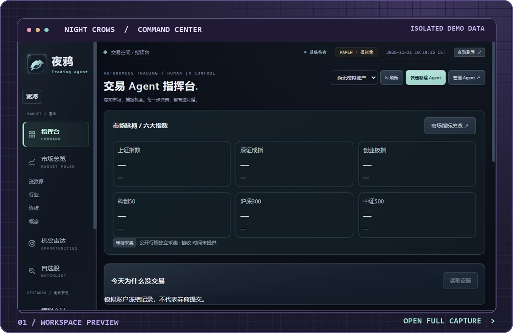](docs/assets/workspace/home.png)

<p align="center"><sub>▲ 点击上方指挥台或下方任一分屏卡片，直接查看未裁剪原始分辨率工作区截图。</sub></p>

<table>
  <tr>
    <td width="50%" valign="top">
      <a href="docs/assets/workspace/market.png">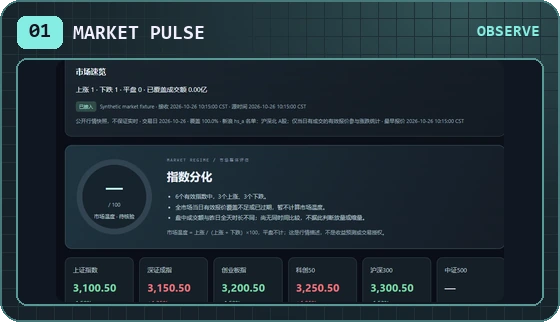</a><br>
       <b>01 · 市场脉搏与广度透视</b>&nbsp;<br>
      <sub>先看指数强弱、涨跌家数广度与成交温度，再顺着行业轮动、量比异动与连板梯队定位当日研究线索。</sub>
    </td>
    <td width="50%" valign="top">
      <a href="docs/assets/workspace/decision.png">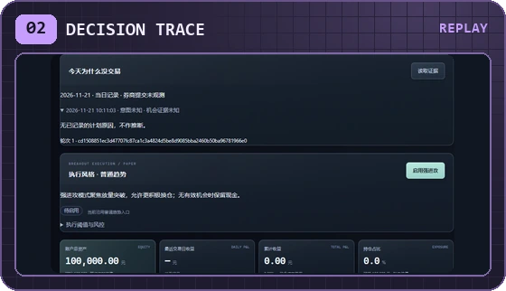</a><br>
       <b>02 · 冻结轮次与未交易穿透</b>&nbsp;<br>
      <sub>不止记录成交：把那一轮看到的候选、目标计划、可用现金与风控拦截条件逐项摊开，回答「今天为什么没买」。</sub>
    </td>
  </tr>
  <tr>
    <td width="50%" valign="top">
      <a href="docs/assets/workspace/candidate.png">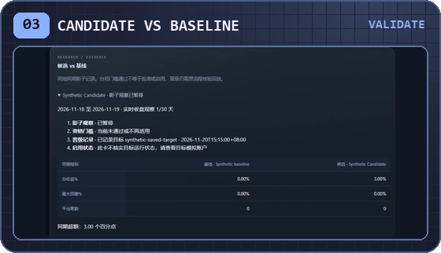</a><br>
       <b>03 · 同组同期影子候选对照</b>&nbsp;<br>
      <sub>在同一股票池、同时段行情与一致费率约束下对比候选与固定基线，将净值领先、观察期进度、批准与启用严格拆开。</sub>
    </td>
    <td width="50%" valign="top">
      <a href="docs/assets/workspace/data-health.png">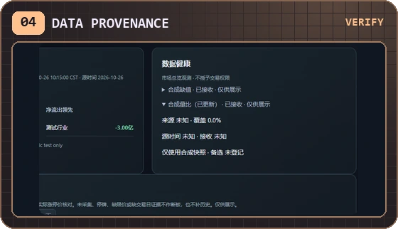</a><br>
       <b>04 · 数据健康与展示源边界</b>&nbsp;<br>
      <sub>逐表核验来源、源时间、接收时间、覆盖缺项与 <code>display_only</code> 许可边界，拒绝把缺报价误判为零波动。</sub>
    </td>
  </tr>
</table>

> [!NOTE]
> **截图数据声明**：本页展示的所有工作区画面均采自**源码候选隔离合成环境（暂停状态）**，仅用于呈现界面结构与证据链路，不代表实盘连接、真实用户账户或任何历史收益证明。更多分屏原图见 **[完整工作区图册 →](docs/workspace-gallery.md)**；与公开安装包对照请看 [v2.0.33 同版截图](SCREENSHOTS.md)。

###  原版夜鸦量化终端 vs 简洁上班模式（双皮肤热切换）

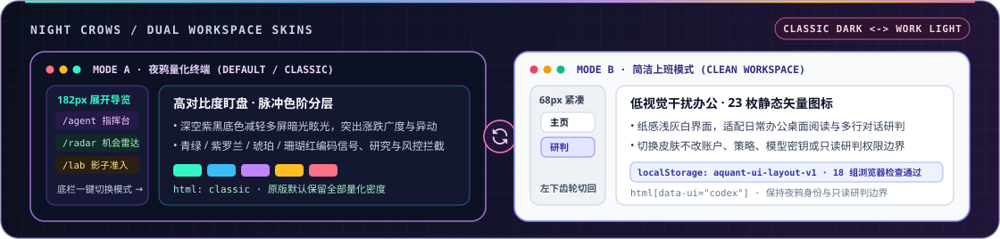

| 对比维度 | 原版夜鸦量化终端（`classic` · 默认） | 简洁上班模式（`codex` · 浅色办公） | 一致性保障 |
| --- | --- | --- | --- |
| **视觉调性与字体** | 深空紫黑底色 + 青绿/紫罗兰/琥珀脉冲分层，降低多屏暗光眩光 | 纸感暖白浅灰底色 + 低饱和边框排版，适配日常办公阅读与长对话 | 仅作用于 `html[data-ui="codex"]` 样式层 |
| **左栏与顶栏交互** | `182px` 完整分组导览 ↔ `68px` 图标紧凑轨，底栏一键切换上班模式 | 紧凑左轨 + `23` 枚本地静态矢量图标，左下角齿轮一键切回原版 | 偏好仅存本机 `aquant-ui-layout-v1` |
| **账户、权限与回归** | 完整呈现盘面密度、指挥台状态卡片与策略研究抽屉 | 保持「夜鸦」身份与「只读研判」副驾边界，多行输入法友好 | **切换皮肤不改动任何账户、策略或交易权限**（通过 `18` 组隔离浏览器检查，见[双皮肤说明](GUIDE.md#3-第一次研究)） |

<p align="center"></p>

<a id="为什么用夜鸦"></a>

##  02 · 为什么用夜鸦：五阶证据闭环

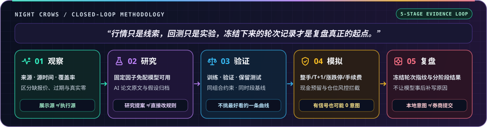

| 闭环阶段 | 常见个人量化痛点 | 夜鸦多保留的证据结构 | 硬性防线标签 |
| --- | --- | --- | --- |
|  **01 · 观察** | 缺行情时静默填 `0`，把公开网页爬取数据直接混作策略成交输入 | 同时记录**数据源、源时间、本地接收时间、覆盖率与使用许可**；严格区分缺报价、已过期与真实观测为零 |  `展示源 ≠ 执行源` |
|  **02 · 研究** | 强依赖昂贵大模型才能跑策略，或让大模型直接改写线上规则参数 | **固定因子路线零模型可用**；AI 路线将论文原文切片、模型原始输入输出、可表达参数假设与失败原因独立归档 |  `提案 ≠ 直接改规则` |
|  **03 · 验证** | 反复调参挑出唯一好看的净值曲线，缺乏同期同约束基线对照 | 强制切分**训练 / 验证 / 保留测试**三段样本，固定基线同组同期影子运行，记录参数扰动与重复无效规则 |  `短期领先 ≠ 通过准入` |
|  **04 · 模拟** | 理想化按收盘价满仓成交，忽略整手、T+1 锁仓、涨跌停与现金预留 | 逐笔核验 **100 股整手、T+1 可卖股数、涨跌停封板、双边费率、预留现金与组合仓位上限**；交易执行绝不阻塞等待模型网络 |  `信号成立 ≠ 产生买单` |
|  **05 · 复盘** | 事后让大模型「看图编故事」解释盈亏，或用今日复权数据覆盖当时状态 | 冻结每轮输入哈希、拦截条件与收盘后 `5/15/30m` 真实观察，历史回放只读当时档案；本地纸面意图与券商提交状态严格分列 |  `本地意图 ≠ 券商提交` |

<details>
<summary> <b>展开深入了解：夜鸦的三个底层诚实不变量（未知语义 · 影子观察期 · 经历反馈闭环）</b></summary>


1. **未知值绝不坍缩为零（`missing / stale / not_observed ≠ 0`）**：无论是行情快照缺项、数据源健康度超出 60 秒窗口，还是模拟账本未接入真实券商回执，系统均显式落盘 `unknown`、`stale` 或 `not_observed`，防止下游统计或 AI 副驾把「没拿到数据」曲解为「价格没动 / 没有提交」。
2. **影子观察期与人工准入分离**：候选策略即便在样本外测试或数日影子观察中扣费收益高于基线，只要未满预设观察窗口（如 `20` 个交易日收盘核对）或未获显式批准，系统绝不静默替换正在运行的基线规则。
3. **「3 自身经历 + 3 论文研究 + 2 复盘教训」结构化记忆**：收盘学习模块按版本归档模拟成交后的 `5 / 15 / 30` 分钟市场反馈（缺报价时保留空缺，绝不插值造价），供下一轮模型研究检索自身真实踩坑记录，而非空谈泛化金融常识。详见 策略知识沉淀 与 模型经历学习。

</details>

<p align="center"></p>

<a id="功能地图"></a>

##  03 · 左栏 4 组 × 10 页全量功能地图

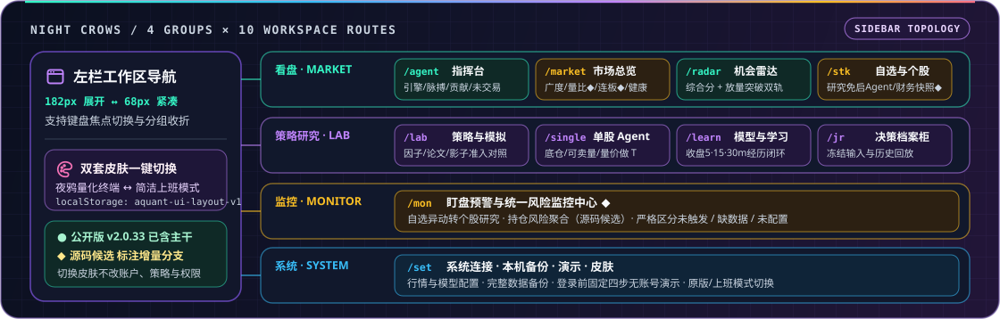

<p>
  <b>能力状态图例：</b>&nbsp;
   公开安装版 <code>v2.0.33</code> 已内置　·　
   主干源码候选增量能力（待下一公开版合入）　·　
   需用户自备本地 Python 3.12 + PyTorch 训练环境
</p>

###  第一组：看盘与线索发现（4 页）

| 路由与模块 | 状态口径 | 核心能力与证据链细节 | 专题文档 |
| --- | --- | --- | --- |
|  **`/agent` 指挥台** |  | 一屏统览模拟引擎状态、账户净值、可用现金、持仓集中度、市场脉搏、当日交易计划与**未交易拦截记录**；支持展开当日单股贡献，严格拆分持仓浮盈与已实现损益 | 每日贡献口径 |
|  **`/market` 市场总览** | <br> | 聚合核心指数、涨跌家数广度、成交额分位、板块强弱与**数据健康能力矩阵**；公开版的连板与概念入口用于查看数据覆盖，不等同实时榜单；源码候选新增**量比异动榜、连板晋级梯队与涨跌停统计面板** | 市场总览规范 |
|  **`/radar` 机会雷达** |  | **多因子综合打分**与**放量突破聚焦池**双轨并行扫描；将「触发信号」「明确无信号」与「报价缺失未知」三态分列，支持一键送入个股深度研究 | 突破聚焦 · 突破池 |
|  **`/stk` 自选与个股** | <br> | 查看自选池、个股多周期量价结构与单标的独立研判报告（**浏览与分析绝不自动启动交易 Agent**）；源码候选补充个股财务摘要与核心估值快照 | 单股研究边界 |

###  第二组：策略研究、受约束模拟与档案回放（4 页）

| 路由与模块 | 状态口径 | 核心能力与证据链细节 | 专题文档 |
| --- | --- | --- | --- |
|  **`/lab` 策略与模拟** | <br> | 管理多模拟账户净值、持仓可卖量与手续费明细；提供**固定因子实验、AI 论文/文章规则提取（`pypdf`）、参数扰动检验、候选 vs 基线同组影子准入**，以及可选本地 PyTorch 滚动训练入口 | 2.0 研究验收 · 策略知识 |
|  **`/single` 单股 Agent** |  | 面向单只重点标的建立独立底仓观察与盘中做 T 计划，联动核对 **T+1 可卖股数、量价分时触发带、回补价差与日内仓位守恒**，杜绝做 T 收益重复计入 | 量价做 T · 单股计划 |
|  **`/learn` 模型与学习** |  | 拆分展示模型历史评分、版本演进、研究失败原因与 Token 预算；收盘后自动归档模拟成交及 `5/15/30m` 后续表现，沉淀可检索的实战经历库 | 模型经历学习 · 统计检验协议 |
|  **`/jr` 决策档案柜** |  | 集中检索已冻结的轮次快照、论文摘录、模型原始 Prompt/Response、影子准入报告与**确定性历史回放摘要**，严格按当时已知数据复现 | 决策档案柜 |

###   第三组 & 第四组：风险监控与本机系统底座（2 页）

| 路由与模块 | 状态口径 | 核心能力与证据链细节 | 专题文档 |
| --- | --- | --- | --- |
|  **`/mon` 盯盘预警与监控中心** | <br> | 跟踪自选异动并一键转入个股研究；将盘中异动预警与已有模拟持仓回撤/封板风险同屏聚合的**统一监控中心**为源码候选；明确区分「未触发」「缺数据」「未配置」 | 八项与 UI 进度 |
|  **`/set` 系统连接 · 备份 · 皮肤** | <br> | 配置公开行情源与自有大模型 API、执行本机工作区备份、切换**原版 / 上班模式**界面布局、进入登录前四步离线演示，并衔接只读 HTTP v1 与源码 MCP 扩展 | [2.0 安装说明](GUIDE.md) · [双皮肤说明](GUIDE.md#3-第一次研究) |
<p align="center"></p>

<a id="快速开始"></a>

##  04 · 快速开始：四条上手路径

<table>
  <tr>
    <td width="50%" valign="top">
       <b>路线 A · 零配置离线体验（3 分钟）</b>&nbsp;<br>
      <ol>
        <li>前往 <a href="https://github.com/JefferyCYH/NIGHT-CROWS-TRADING-RELEASES/releases/latest">GitHub Releases</a> 下载单文件 Windows x64 安装器，按 <a href="https://github.com/JefferyCYH/NIGHT-CROWS-TRADING-RELEASES/blob/main/GUIDE.md">使用指南</a> 校验 SHA-256。</li>
        <li>安装至本人可写目录，手动双击 <code>aquant.exe</code>（安装器绝不静默自启软件或启动交易）。</li>
        <li>在登录页点击<b>「无账号体验只读演示」</b>，无需任何 API 密钥、无需券商账号、不联网取数即可跑通完整证据链。</li>
      </ol>
    </td>
    <td width="50%" valign="top">
       <b>路线 B · 固定因子首轮研究与模拟</b>&nbsp;<br>
      <ol>
        <li>创建本机私有工作区并登录；老版本升级前请先有序退出程序并备份数据目录。</li>
        <li>打开<b>「快速新建 Agent」</b>设定股票池、初始资金与风控上限，直接选用内置<b>固定因子模板</b>（免配大模型）。</li>
        <li>核验冻结的训练 / 验证 / 保留测试指标与准入状态，手动确认启动<b>纸面模拟</b>，随后在指挥台与档案柜复盘每轮依据。</li>
      </ol>
    </td>
  </tr>
  <tr>
    <td width="50%" valign="top">
       <b>路线 C · 接入自有模型与可选深度学习</b>&nbsp;<br>
      <ol>
        <li>在 <code>/set</code>「系统连接」填入自有兼容模型服务密钥，即可开启 AI 论文拆解、假设生成与指挥台 <b>AURA 只读副驾</b>。</li>
        <li>所有模型提案均须先转化为可检验的规则试验并通过影子准入，系统严禁模型直接篡改线上执行参数。</li>
        <li>如需体验滚动深度学习训练，可在本地额外配置 Python 3.12 + <code>torch</code> + <code>numpy</code>（公开安装包保持轻量不捆绑）。</li>
      </ol>
    </td>
    <td width="50%" valign="top">
       <b>路线 D · 源码检出与只读二开接入</b>&nbsp;<br>
      <ol>
        <li>拥有源码仓库访问权限的开发者建议使用 <b>Python 3.12</b> 安装 <code>requirements.txt</code>。</li>
        <li>直接运行 <code>examples/</code> 下的确定性行情适配与证据查询 CLI，或启动 <code>src/app/evidence_mcp.py</code> 接入外部智能体。</li>
        <li>执行 <code>unittest</code> 示例回归套件，自动构造临时 SQLite/JSON 隔离账本并校验输入字节零篡改。</li>
      </ol>
    </td>
  </tr>
</table>

<a id="第一次打开四步看懂一条决策"></a>

###  第一次打开：四步看懂一条「为什么没交易」的冻结决策

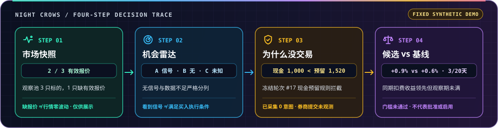

| 演示步骤 | 画面呈现的固定合成证据 | 夜鸦给出的复盘结论 | 关键口径标签 |
| --- | --- | --- | --- |
|  **Step 01 · 市场快照** | 观察池共 `3` 只标的，仅 `2` 只返回有效报价，`1` 只缺报价 | 先核对覆盖率：**缺报价不等于涨跌幅为零**，展示快照亦不自动获得执行资格 |  |
|  **Step 02 · 机会雷达** | 标的 `A` 触发信号，标的 `B` 无信号，标的 `C` 因缺数据标记未知 | 「明确无信号」与「数据不足未知」严格分列；**看到买点信号不代表账户允许下单** |  |
|  **Step 03 · 为什么没交易** | 冻结轮次记录可用现金 `1,000` 元，低于风控预留现金需求 `1,520` 元 | 被现金预留硬约束拦截，该轮产生纸面意图数 `0`；真实券商提交状态仍记为 `not_observed` |  |
|  **Step 04 · 候选 vs 基线** | 候选策略扣费收益 `+0.9%`，同期基线 `+0.6%`，收盘观察进度 `3 / 20` 天 | 虽短期净值领先，但**观察窗口未满 20 天，未达准入门槛**，更不等于已批准或已启用 |  |

[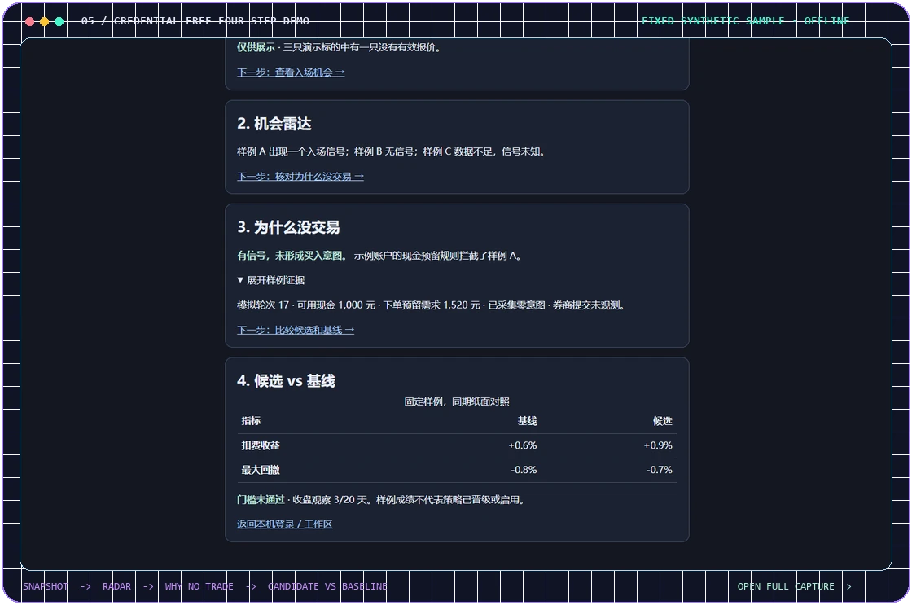](docs/assets/workspace/demo.png)

<p align="center">
  <sub>▲ 固定合成离线样例实拍（不联网、不对应真实证券或账户） · 关联原图：<a href="docs/assets/workspace/demo.png">无账号演示全图</a> · <a href="docs/assets/workspace/decision.png">未交易轮次证据</a> · <a href="docs/assets/workspace/candidate.png">影子准入对照</a></sub>
</p>

<p align="center"></p>

<a id="架构与数据流"></a>

##  05 · 系统架构、进程隔离与数据流

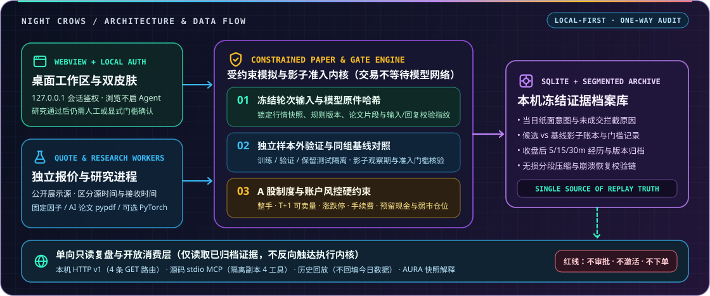

<table>
  <tr>
    <td width="50%" valign="top">
       <b>1. 桌面工作区与本机认证壳层</b><br>
      <sub>基于 Windows <code>pywebview</code> 承载双套皮肤界面，后端 HTTP 默认仅绑定 <code>127.0.0.1</code> 本机回环地址，私有路由强制校验已登录工作区会话且返回 <code>Cache-Control: no-store</code>。</sub>
    </td>
    <td width="50%" valign="top">
       <b>2. 报价与研究双独立 Worker 解耦</b><br>
      <sub>行情拉取（主源截止超时与解压边界受控）与长耗时策略研究（<code>pypdf</code> 论文解析、统计回测、可选模型推理）运行在受管子进程，防止网络抖动或大计算卡死桌面交互。</sub>
    </td>
  </tr>
  <tr>
    <td width="50%" valign="top">
       <b>3. 受约束纸面模拟与影子准入内核</b><br>
      <sub>盘中模拟轮次仅消费已冻结的规则参数与行情快照，<b>绝不在线等待外部大模型响应</b>；所有成交均经过 A 股整手、T+1、涨跌停、双边成本与账户风控闸门核验。</sub>
    </td>
    <td width="50%" valign="top">
       <b>4. SQLite 账本 + 无损分段归档底座</b><br>
      <sub>热态查询走受控 SQLite（含过期遥测清理，源码候选新增 <code>50,000</code> 行上限轮转），历史事件流采用分段无损压缩与哈希校验链落盘，支撑崩溃恢复与单向只读外部审计。</sub>
    </td>
  </tr>
</table>

<details>
<summary> <b>展开查看：AI 研究 → 样本外验证 → 纸面模拟 → 经历反馈详细流程图与技术栈清单</b></summary>


| 技术层级 | 仓库模块与关键实现 | 工程职责与约束边界 |
| --- | --- | --- |
| **桌面与前端层** | `src/app/app.py` · `src/app/web/` (`classic` / `codex-ui.js` / `companion.js`) | 原生窗口生命周期、托盘隐藏恢复、左栏 4 组 10 页路由、双皮肤切换与 18 组浏览器隔离回归 |
| **行情与适配层** | `examples/read_index_source.py` · 内部受控报价管线 | 区分 `source_time` 与 `received_time`，主源截止熔断，公开展示源强制标记 `display_only` |
| **实验室与学习层** | 固定因子引擎 · `pypdf` 论文切片 · 收盘 `5/15/30m` 经历流式聚合 | 训练/验证/保留测试隔离、参数扰动去重、流式读取历史经历降低 Python 内存分配峰值 |
| **存储与恢复层** | SQLite (WAL 受控回收) · 分段事件归档与恢复回放器 | 事务化代码升级备份与故障回滚（`1,808` 文件核验）、分段压缩保留完整恢复校验链 |
| **开放生态层** | `/api/v1/evidence/*` · `src/app/evidence_mcp.py` (MCP SDK `2.2`) | 单向只读暴露已冻结决策、候选进度、回放摘要与数据健康，零下单/零改参接口 |

</details>

<p align="center"></p>

<a id="ai-副驾-aura"></a>

##  06 · AI 副驾 AURA：只读快照解释器 vs 策略实验室

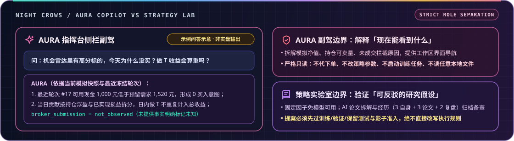

| 你可以在指挥台侧栏问 AURA 什么 | AURA 引用的本机冻结证据 | 严格权责边界 |
| --- | --- | --- |
|  **「今天模拟账户的盈亏是怎么构成的？做 T 算重了吗？」** | 读取当日收盘核对或盘中快照、单股持仓浮盈、已实现平仓损益与交易费率明细；明确日内做 T 收益不重复计入组合净值 |  只解释当前快照，不预测涨跌 |
|  **「机会雷达里有高分标的，为什么刚才那一轮没买？」** | 穿透最近一轮冻结决策记录，核对雷达评分、可用现金、预留现金门槛、T+1 锁仓与弱市仓位上限；未提供的事实一律标记 `unknown` / `not_observed` |  拒绝无中生有补写交易原因 |
|  **「我去哪里核对某篇论文提取的参数和影子观察进度？」** | 直接给出左栏对应工作区入口（如 `/lab` 策略与模拟、`/jr` 决策档案柜、`/learn` 模型学习）与核查步骤 |  **不代下单 · 不改参数 · 不启任务 · 不读任意文件** |

> [!WARNING]
> **隐私与外发边界提示**：仅当你在「系统连接」主动配置外部大模型并在侧栏向 AURA 提问时，系统才会把回答所需的当前模拟账户快照摘要发送至你所配置的模型服务端。**不使用 AURA 对话时零上下文外发**；固定因子研究、纸面模拟与无账号离线演示均完全不依赖外部大模型。

<p align="center"></p>

<a id="开放接口"></a>

##  07 · 单向只读开放生态：HTTP v1 · stdio MCP v1 · 数据适配

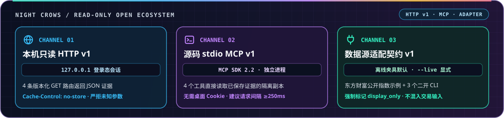

###  通道 A · 本机只读证据 HTTP v1（桌面已登录工作区会话）

本机 HTTP 证据接口仅向当前已登录的桌面会话开放（未登录请求直接拒绝，无账号演示不读取私有路由），不向任何第三方转发 Cookie 或模型密钥：

| 方法 | 版本化路由路径 | 查询参数 | 返回的冻结证据负载 |
| --- | --- | --- | --- |
|  | `/api/v1/evidence/data-health` | 无（严拒未知查询参数） | 数据源能力矩阵、源时间/接收时间与可用性观察口径 |
|  | `/api/v1/evidence/decisions` | `id`、`date`（北京时间 `YYYY-MM-DD`），可选 `limit` | 指定日期已冻结的模拟决策轮次、目标意图与风控拦截详情 |
|  | `/api/v1/evidence/candidate-progress` | `id`、`group` | 已保存的同组候选 vs 基线净值对照、观察期天数与门槛评估 |
|  | `/api/v1/evidence/replay-report` | `id` | 已归档的历史回放摘要与一致性核验结果（**只读快照，不重跑回放**） |

###  通道 B · 源码独立进程 `stdio MCP v1` 与数据源适配 CLI

拥有源码权限时，可通过 `MCP SDK 2.2` 启动独立 `stdio` 进程接入外部 AI 客户端，直接读取**已保存证据目录的隔离副本**（无需启动桌面端、无需传入登录凭据，建议客户端请求间隔 `≥ 250 ms`）：

| 开放组件 | 名称 / 入口 | 参数与输入契约 | 行为与安全语义 |
| --- | --- | --- | --- |
|  | `decisions` | `id`, ISO `date`, 可选 `limit` | 读取隔离副本中的模拟决策；`unknown` ≠ 零意图，`not_observed` ≠ 确认未提交 |
|  | `candidate_progress` | `id`, `group` | 读取影子比较组进度、门槛与既有晋级记录；**不提交审批、不激活候选** |
|  | `replay_report` | `id` | 读取已保存的历史回放核验摘要，不触发计算任务 |
|  | `data_health` | 无（读取 `--health-snapshot` 导出的纯响应 JSON） | `60s` 内生成判为 `current`，缺失判为 `missing`，超期判为 `stale`；绝不含 Cookie |
|  | `examples/read_index_source.py` | 默认离线确定性夹具；显式 `--live` 访问东方财富公开接口 | 输出标准化指数快照 JSON，强制标记 `display_only`，严禁直接充当交易执行输入 |

```powershell
# 1. 安装源码依赖（建议 Python 3.12）并运行默认确定性行情适配示例
python -m pip install -r requirements.txt
python examples/read_index_source.py

# 2. 对已有实验数据的【隔离副本】执行决策查询与候选对照 CLI
python examples/query_decisions.py --data-root 'C:\aq-test\data' --id paper --date 2026-11-20 --limit 12
python examples/compare_candidate.py --data-root 'C:\aq-test\data' --id paper --group comparison-id

# 3. 启动独立只读 stdio MCP 服务（供支持 MCP 协议的客户端挂载）
python src/app/evidence_mcp.py --data-root C:\absolute\isolated-data --health-snapshot C:\absolute\health.json

# 4. 无现成样本时，一键自建临时 SQLite/JSON 夹具跑通全部示例回归并校验输入零篡改
python -m unittest discover -s tests -p 'test_*_example.py'
```

> [!TIP]
> 完整字段定义、原子导出健康快照规范、错误码与未知值处理细则请查阅：**二开命令行示例** · **只读证据 MCP v1 规范** · **数据源适配契约 v1**。

<p align="center"></p>

<a id="配置与本机数据"></a>

##  08 · 本机工作区隔离、无损归档与安全升级

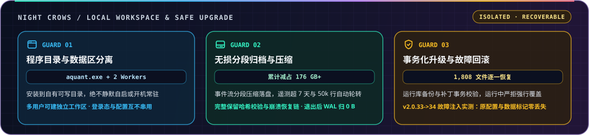

| 使用场景 | 所需条件与目录边界 | 安全升级与数据治理机制 |
| --- | --- | --- |
|  **零配置浏览与演示** | Windows x64 单文件安装包；登录页直入固定样例 | **零密钥、零券商账号、零私有目录写入**，关闭窗口即干净退出 |
|  **建立个人研究工作区** | 自有可写安装目录 + 覆盖目标标的与时段的历史/公开数据 | 程序运行库（`aquant.exe` + Workers）与用户账本/配置严格分离；登录凭据、模型密钥与研究档案绝不入库 Git |
|  **接入外部行情或模型** | 在 `/set`「系统连接」填入自有模型服务或启用公开行情源 | 本机工作区不等于所有功能均离线：启用外部模型或 `--live` 公开源会产生出站网络请求，请自行确认授权、资费与隐私条款 |
|  **保留数据事务化升级** | 先退出运行中的夜鸦并执行本机备份，运行完整新版安装器指向原目录 | 严禁在程序运行中强行覆盖或混装跨版本补丁；安装事务支持运行库快照与故障自动回滚（见 [升级与回退指南](https://github.com/JefferyCYH/NIGHT-CROWS-TRADING-RELEASES/blob/main/GUIDE.md#4-保留数据升级) · [安装事务设计](GUIDE.md#4-保留数据升级)） |
|  **长期运行存储治理** | 自动分段事件归档 + 目录级无损压缩 + 遥测 SQLite 定期轮转 | 遥测库保留 `7` 天内记录，源码候选新增默认 `50,000` 行上限轮转回收；分段归档完整保留块哈希与崩溃恢复回放链（见 事件归档 · 存储压缩） |

<p align="center"></p>

<a id="性能验收与安全边界"></a>

##  09 · 性能实测账本、打包验证与诚实红线

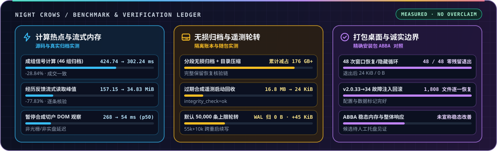

夜鸦坚持将**源码微基准、隔离合成负载、精确安装包桌面生命周期与盘中实盘环境**分开计量，不拿单次低值充当全面提速证明：

| 专项验证维度 | 实测前后指标对比 | 验证环境、样本口径与明确的不夸大边界 | 审计记录入口 |
| --- | --- | --- | --- |
|  **成组信号计算内核** | **`424.74 → 302.24 ms`**<br>（耗时下降 **`-28.84%`**） | 基于 `46` 组真实归档输入、双进程交替预热对标，输出成交信号逐笔一致；**仅计量纯信号计算核，不含网络拉取报价与账本落盘耗时** | 资源优化 218 · 2.0 验收 |
|  **经历反馈流式读取** | **`157.15 → 34.83 MiB`**<br>（分配峰值 **`-77.83%`**） | 基于 `24` 条真实归档事件追踪 Python 内存分配峰值，逐事件指纹核验一致；消除全量历史一次性反序列化驻留 | 经历内存 219 · 2.0 验收 |
|  **无损归档与目录压缩** | **累计减占 `176 GB+`** | 针对长期演进大体积事件账本实施分段无损归档与存储压缩，完整保留分段哈希校验与崩溃恢复回放链 | 存储压缩 · 空间账本 |
|  **遥测 SQLite 回收轮转** | **`16.8 MB → 24 KiB`**<br>（退出后 `WAL = 0 B`） | 预置 `>7` 天过期样本启动回收（`16,805,888 → 24,576 B`，`integrity_check=ok`）；默认 `50,000` 行上限下跨重启写入 `55k + 10k` 行净增 `+45,056 B`（**属合成压测，非盘中自然吞吐**） | 八项与性能账本 |
|  **暂停合成账户切换** | **`268 → 54 ms`（p50）**<br>（`267.5 → 53.7 ms`） | 消除切户首包目录竞争并引入请求代数隔离，准确渲染目标指挥台；**属暂停态合成样本 DOM 观察，非屏幕光栅绘制或盘中实盘延迟** | 切户代数隔离 · 八项账本 |
|  **安装包 ABBA 窗口循环** | **`48 / 48` 零残留退出**<br>（主库 `24 KiB` / `WAL 0 B`） | 精确安装包 `v2.0.33` 与候选串行 4 轮 ABBA 对照共 `48` 次窗口恢复/隐藏循环，全部干净退出；**未观测到稳态内存或整体响应显著改善，如实记录不虚报** | 桌面后台运行 · 有序退出 |
|  **故障注入回滚与回归门** | **`1,808` 文件完整恢复**<br>（`193 + 26` 测试通过） | `v2.0.33 → v2.0.34` 故障注入升级自动回滚全部 `1,808` 个文件且原配置/数据标记零丢失；源码门禁通过 `193` 项 Python 回归 + `26` 项桌面生命周期测试 | 构建与分发手册 |

> [!CAUTION]
> **安全、合规与非商用红线声明**
> - **严禁商用与实盘承诺**：夜鸦（Night Crows）仅供个人量化研究、软件架构验证与决策证据复盘学习使用，**严禁任何商业用途**，不构成任何证券投资建议、未来收益暗示或真实券商实盘执行保证。
> - **未验收边界透明公开**：真实券商交易柜台长时接入与完整交易时段自然调度尚未作为公开版验收结论；候选版已完成隔离盘中自然调度与重启验证；在通过 Windows 系统托盘人工操作见证前，不升格为正式公开 Release。公开安装包编译字节码仅用于常规分发打包，不等同于防逆向加密容器。

<p align="center"></p>

<a id="文档索引"></a>

##  10 · 版本演进与专题文档中枢

###  版本里程碑对照

| 版本标识 | 发布通道与定位 | 关键交付内容与核验状态 | 对应入口 |
| --- | --- | --- | --- |
| **`v2.0.21`** | 历史公开基线 | 首个面向外部独立安装的 Windows x64 桌面工作区基线与升级校验规范 | [2.0.21 发布记录](https://github.com/JefferyCYH/NIGHT-CROWS-TRADING-RELEASES/releases/tag/v2.0.21) |
| **`v2.0.32`** | 历史公开迭代 | 桌面运行连续性、子进程清理、窗口恢复与配置保护加固 | [2.0.32 更新说明](https://github.com/JefferyCYH/NIGHT-CROWS-TRADING-RELEASES/releases/tag/v2.0.32) |
| **`v2.0.33`** |  **当前公开安装版** | 完整单文件安装器、固定因子与 AI 研究闭环、A 股受约束模拟、AURA 只读副驾、只读 HTTP v1 与双皮肤基础（源码 MCP 不随包） | [下载 Latest Release](https://github.com/JefferyCYH/NIGHT-CROWS-TRADING-RELEASES/releases/latest) · [CHANGELOG](https://github.com/JefferyCYH/NIGHT-CROWS-TRADING-RELEASES/blob/main/CHANGELOG.md) |
| **`v2.0.34`** |  **源码候选草案** | 左栏 4 组 10 页与上班模式打磨、量比/连板/财务快照、统一风险监控中心、遥测 `50k` 轮转与切户代数隔离（**待人工托盘见证，未公开发布**） | 八项与 UI 验收账本 |

###  专题工程文档中枢（按领域直达）

未设链接的专题名称对应私有源码仓库资料，本仓库不公开这些文档或示例文件。

<table>
  <tr>
    <td width="50%" valign="top">
       <b>安装升级、工作区图册与界面交互</b>
      <ul>
        <li><a href="https://github.com/JefferyCYH/NIGHT-CROWS-TRADING-RELEASES/blob/main/GUIDE.md">公开安装、SHA-256 校验与保留数据升级指南</a></li>
        <li><a href="GUIDE.md">2.0 本机部署与环境要求</a> · 2.0 演进路线图</li>
        <li><a href="docs/workspace-gallery.md">高清工作区全幅截图图册</a> · <a href="GUIDE.md#3-第一次研究">原版与简洁上班模式双皮肤规范</a></li>
        <li>市场总览与数据健康口径 · 每日单股损益贡献拆分</li>
      </ul>
    </td>
    <td width="50%" valign="top">
       <b>因子研究、AI 论文拆解与受约束模拟</b>
      <ul>
        <li>2.0 研究与模拟综合验收报告 · 存储与学习迭代纪要</li>
        <li>AI 论文沉淀与决策档案柜 · 收盘后 5/15/30m 经历学习</li>
        <li>样本外统计检验协议 · 放量突破聚焦 · 突破池构建</li>
        <li>单股 Agent 边界设计 · 底仓量价做 T 核算</li>
      </ul>
    </td>
  </tr>
  <tr>
    <td width="50%" valign="top">
       <b>单向只读开放生态与二开示例</b>
      <ul>
        <li>二开命令行示例总览（零桌面凭据隔离运行）</li>
        <li>只读证据 stdio MCP v1 接入与快照新鲜度规范</li>
        <li>数据源适配契约 v1（display_only 与未知值语义）</li>
        <li>源码示例脚本：<code>read_index_source.py</code> · <code>query_decisions.py</code> · <code>compare_candidate.py</code></li>
      </ul>
    </td>
    <td width="50%" valign="top">
       <b>性能优化、无损归档与发布门禁</b>
      <ul>
        <li>八项能力、UI 打磨与性能专项完整验收账本</li>
        <li>成组信号计算优化（218） · 经历读取流式降内存（219） · 切户代数隔离</li>
        <li>分段事件归档 · 崩溃恢复回放 · 无损压缩 · 存储足迹</li>
        <li>安装包构建与故障回滚验证 · 公开分发规则 · <a href="GUIDE.md#4-保留数据升级">代码安装事务</a> · <code>src/app</code> 源码入口</li>
      </ul>
    </td>
  </tr>
</table>

<br>


<div align="center">

<br>

<kbd><a href="#top">⬆️ 回到顶部</a></kbd>&nbsp;&nbsp;·&nbsp;&nbsp;<kbd><a href="https://github.com/JefferyCYH/NIGHT-CROWS-TRADING-RELEASES/releases/latest">📦 下载公开版 v2.0.33</a></kbd>&nbsp;&nbsp;·&nbsp;&nbsp;<kbd><a href="docs/workspace-gallery.md">🖼️ 工作区原图图册</a></kbd>&nbsp;&nbsp;·&nbsp;&nbsp;<sub><a href="USAGE.md">不可用于商用，仅供学习。</a> · 研究交流与合作微信：<code>JefferyCYH</code></sub>

</div>
