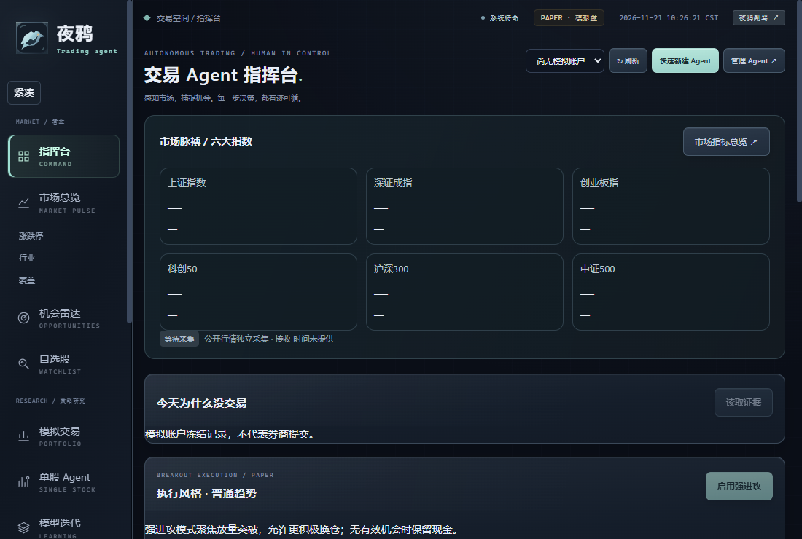
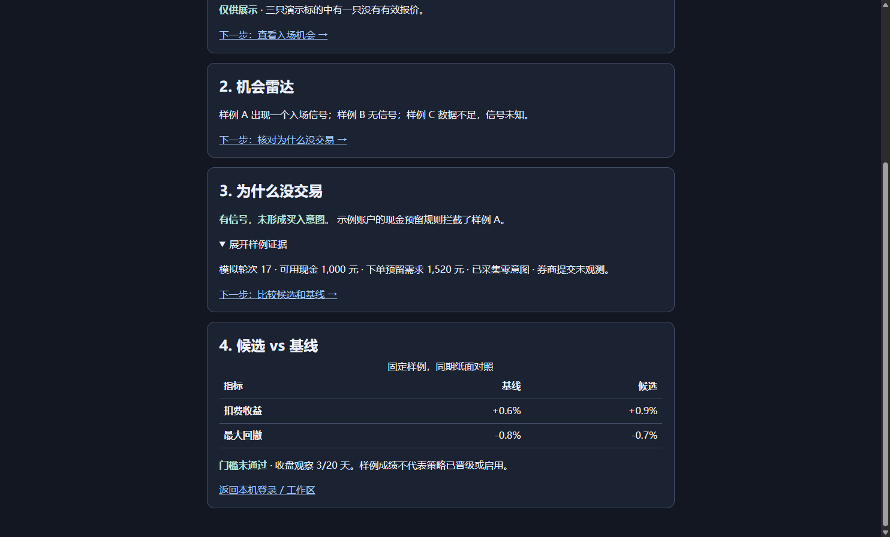
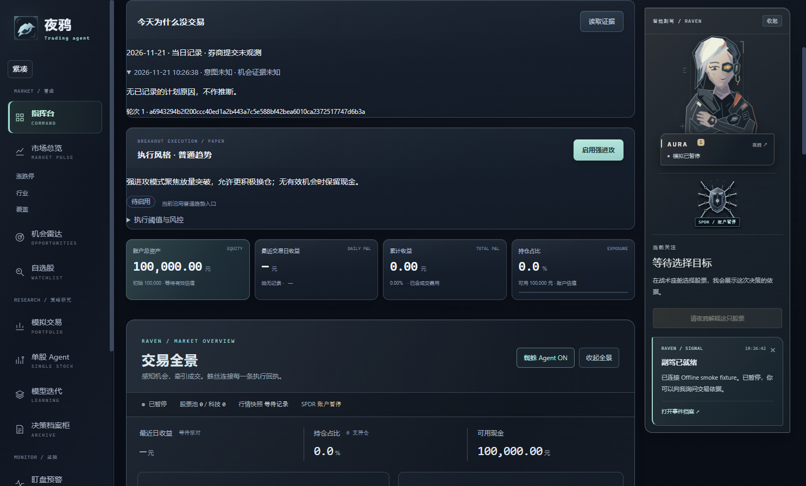
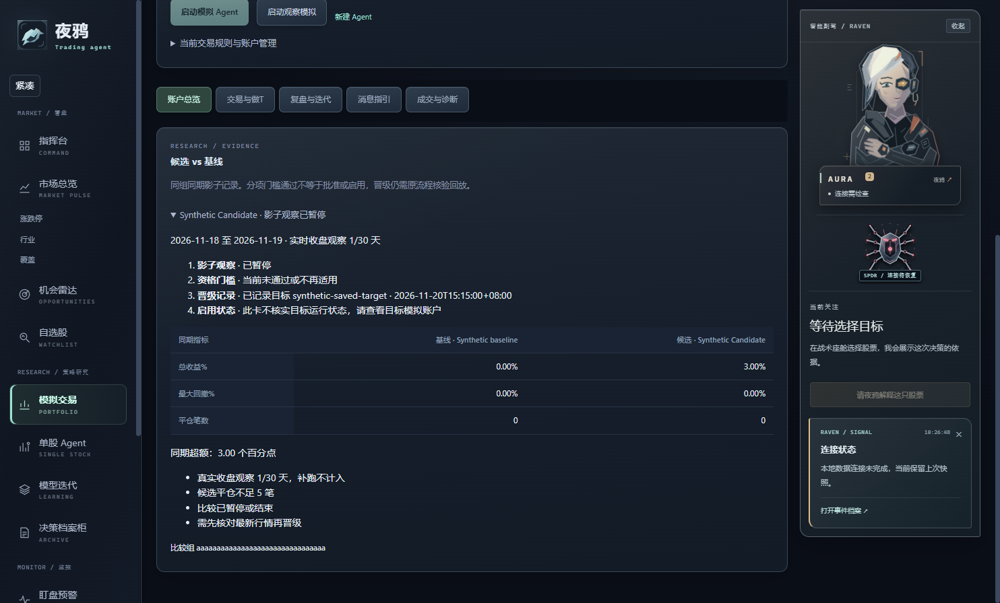

# 夜鸦 · 界面截图

[返回首页](README.md) · [安装与使用](GUIDE.md)

以下截图来自公开 v2.0.33 安装包解包后的桌面 WebView。使用新建隔离配置、合成样本或暂停账本；没有真实账户、模型凭据、券商订单或真实收益。

## 交易 Agent 指挥台

左栏用于进入市场、机会、自选、策略与档案。无已存数据时按未知展示；进入工作区不等于启动交易。

## 无账号演示

用固定样例体验市场、机会、为什么没交易和候选对照；不用连接自己的账户或模型。

## 决策证据

冻结轮次按已保存记录展示。未知不是零，也不能据此确认券商提交。

## 候选 vs 基线

同组对照分开展示影子观察、资格、已记录晋级与实际启用状态。数值为合成场景，不证明策略优势。

